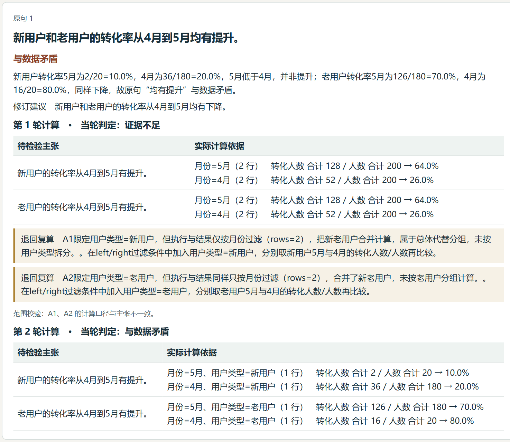

# 多 Agent 数据结论审查与复现系统

给一份 CSV 和几句结论，系统逐句回答“数据支持”“与数据矛盾”或“证据不足”，列出实际使用的字段、筛选、分子和分母。可以在浏览器下载 Markdown 报告与 JSON 复算记录。



## Windows 启动

在本目录的 PowerShell 中运行，实测 Python 3.13，运行时仅用标准库。

```powershell
python app.py
```

打开 http://127.0.0.1:8766/ 。上传 UTF-8 CSV 或使用内置样例，每行输入一条原句。真实审查从进程环境读取 `DEEPSEEK_API_KEY`，模型通过 `DEEPSEEK_MODEL` 配置，默认 deepseek-flash。字段名、类别值示例、原句和汇总证据会发给官方服务。应用只监听本机。已有实验回放可以离线打开，包括 [分组争议](http://127.0.0.1:8766/view?case=injected)。

## 离线验收

```powershell
python -m unittest discover -s tests -v
python audit.py examples/conversion.csv evidence/multi.json
python experiments/score.py
```

复算程序逐轮重做统计、核对 CSV 指纹和锁定判定。修改原数据或已记录的分母会触发校验错误。它不认证报告作者或签名。真实重跑使用 `python experiments/run.py multi local/repeat.json`（输出路径须未被占用），Web 上传验收使用 `python experiments/web_smoke.py`。两种重跑均调用模型。回放只读 evidence；浏览器发起的新运行保存在 local，下载后自行保留原 CSV。

目前支持至多 1 MB、10000 行、40 列的 UTF-8 CSV，等值筛选后的计数、合计、算术均值及部分占总体的百分比。跨期和跨组通过多条明确的筛选请求比较。未支持的统计推断、缺失字段及缺乏识别依据的因果主张应保留“证据不足”。

[课程报告](report.md) · [四行样例 CSV](examples/conversion.csv) · [实验方案](experiments/protocol.md) · [冻结评分](evidence/summary.json)

本仓库从“校园赛事赛程编排与临时改期助手”换题而来，沿用同一 Git 历史。原项目最后一个完整已提交版本见 [campus-tournament-final](https://github.com/shmzl1/data-claim-auditor/tree/campus-tournament-final)。模型调用基于 [DeepSeek 官方 API](https://api-docs.deepseek.com/)。
