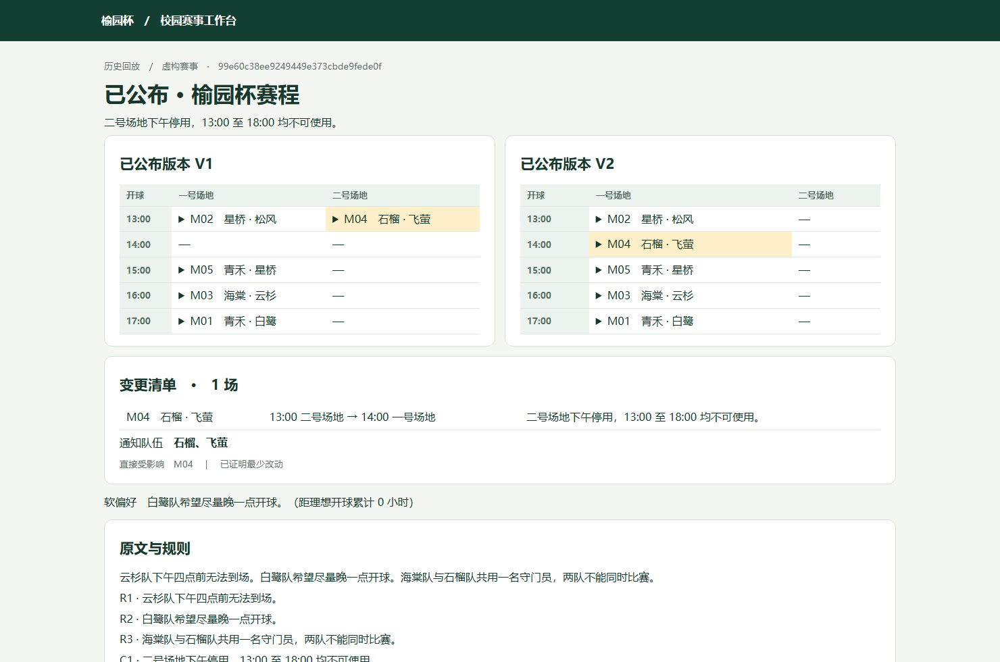

# 校园赛事赛程编排与临时改期助手

虚构的榆园杯共有八支队伍和两块场地。组织者录入对阵与通知，确认规则，审核候选并公布。场地或球队临时有变时，同一页面显示受影响场次、版本差异和需要通知的队伍名单。系统从时间或场地发生变更的比赛中收集参赛队并去重，同一支队涉及多场变更只计一次。实际联系由组织者负责。以下截图来自本机 Edge 打开的真实模型运行回放。



## Windows 启动与回放

在已解压的项目根目录打开 PowerShell。本机实测 Python 3.13.11，无第三方运行依赖。

```powershell
python -m venv .venv
.\.venv\Scripts\python.exe -m pip install -r requirements.txt
.\.venv\Scripts\python.exe app.py
```

打开 http://127.0.0.1:8765/ ，选择历史回放。场地停用可直接打开 http://127.0.0.1:8765/?replay=main 。命令行已有 Python 时可直接运行 `python app.py`。Ctrl+C 停止。服务只监听本机，运行中的赛事写入 local/。

## 真实调用

从当前进程环境读取 DEEPSEEK_API_KEY，可选 DEEPSEEK_MODEL（默认 deepseek-flash）与 TOURNAMENT_MAX_ROUNDS（默认 3）。.env.example 仅说明变量名。若系统尚未配置密钥，在启动程序的同一 PowerShell 窗口执行以下命令，输入内容不会回显：

```powershell
$secret = Read-Host 'DeepSeek API key' -AsSecureString
$env:DEEPSEEK_API_KEY = [Net.NetworkCredential]::new('', $secret).Password
python app.py
```

首页默认填入样例，可编辑八队之间的对阵，每行两队。确认规则后生成候选，完成独立复核后点击公布，再粘贴临时通知。本机真实 HTTP 流程也可通过 `python verify_ui.py` 执行，会产生 API 费用和一份新记录。有效规则仅限当前实现的约束类型，未明确的语义提交组织者澄清。首版网格固定为 13—18 点、整点开球、每场一小时、同队至少休息一小时。

## 验证与证据

```powershell
python -m unittest -v tests
python experiments.py
```

第二条命令离线读取冻结的角色输出，重新求解并更新 evidence/results.json；运行耗时随机器变化。正式推理脚本 formal.py 会拒绝覆盖已有同名记录。复现实验可在独立副本内先将 evidence 改名备份，再依次运行 formal.py 的 main、supplement、normal、injected 参数，运行 fault_pair.py，随后运行 branches.py 的 team、active、tied、impossible 参数。模型服务的重复采样可能给出不同判断。保留旧证据可避免把未复现的结果混入原实验。

|文件|用途|
|---|---|
|sample.py、reference.json|虚构通知、赛程基础参数、运行前冻结的人工答案|
|agents.py|四份角色提示、结构检查、官方 API 调用和用量记录|
|workflow.py、engine.py|版本、复核反馈与终止条件；求解、独立全表校验和差异计算|
|app.py、tests.py|中文工作台和离线验收|
|evidence/main.json、active.json、impossible.json（均在 evidence 下）|真实主线、直接影响名单纠错、无解与试算|
|evidence/injected.json、evidence/pair_fault.json|人工注入后的退回、修订及仍存分歧|
|evidence/pilot/、evidence/prototype/|早期失败或未检出问题的开发运行，未纳入冻结案例的正式统计|
|[实验表](experiments.md)、[报告](report.md)、[课堂脚本](demo.md)、[课件对照](requirements_checklist.md)|现场查证入口|

规则表从未参与模型训练或微调。程序编排独立 API 请求，共用模型服务，身份与原始材料按角色传递；本机无模型权重。Python 标准库承担 HTTP、原子文件替换和测试。本项目由组织者提供需求，借助 Codex 开发并执行实验，赛事数据与界面自行编写。协议参考 [DeepSeek API](https://api-docs.deepseek.com/) 和 [Python 标准库](https://docs.python.org/3/library/)。
