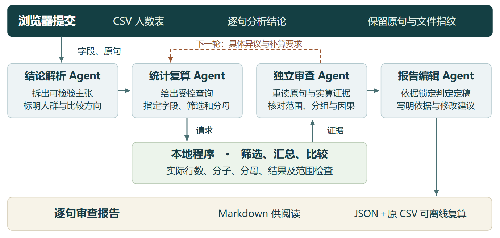

# 多 Agent 数据结论审查与复现系统

选题方向：方向三　多 Agent 协作系统（系统设计）

## 第一章　项目概述

### 1.1 方向选择理由

“总体转化率上升”和“各类用户的转化率都上升”只差几个字，所需的证据却不同。即使除法完全正确，如果没有按照用户类型分组，就不能用总体结果证明第二句话。方向一强调面向用户的交互，方向二强调为智能体提供基础服务；本题最需要验证的是，提出计算方案的人遗漏了限定条件时，另一角色能否重读原句，指出遗漏并要求补算。因此选择方向三，把解析、复算、审查和编辑分给四个角色。

### 1.2 项目目标

使用者是拿到一份数据表、需要核对分析文稿的人。他要知道每句话究竟有数据支持、与数据矛盾，还是证据不足。对于涉及比例的结论，他应能看到实际纳入计算的人群、分子和分母，并把修订后的结论连同依据交给其他人复查。

### 1.3 核心功能

使用者在浏览器上传 CSV，按行粘贴结论。页面保留原句，列出拆出的主张、各轮计算结果、具体异议及修改建议。他可以下载供阅读的 Markdown 报告，也可以下载审查记录，用原始数据在本机重新计算。

## 第二章　系统设计

### 2.1 系统架构图



*图 1　四个角色之间传递的是主张、计算请求和异议。数值由本地程序产生，虚线表示一次补算。*

上传的原句和表结构同时留给审查角色。这样，它能把作者说的“各组”与程序实际读到的行逐一对照。审查意见由控制程序路由：原句拆错就退回解析，筛选或分母错了就退回复算。未消除的分歧达到轮数上限后交回人工核查。

### 2.2 模块说明

| 模块或角色 | 接收什么 | 实际交付 |
|---|---|---|
| 结论解析 Agent | 原句、字段和类别示例 | 带原句编号、人群、比较方向的原子主张 |
| 统计复算 Agent | 原子主张、上轮计算和反馈 | 规定格式的指标、分子分母与两侧筛选请求 |
| 本地统计程序 | 原 CSV 与结构化请求 | 匹配行数、实际分子分母、结果和数值比较 |
| 独立审查 Agent | 原句、拆分结果、实际执行的请求及证据 | 受影响的主张编号、异议、应补算的范围 |
| 报告编辑 Agent | 已核实的证据与锁定判定 | 每条原句的理由和可用的修订建议 |
| Web 端与记录 | 上传、模型事件与计算轮次 | 逐句页面、历史回放、Markdown 与 JSON 下载 |

一句话可对应多个原子主张，而原句编号保持不变。例如作者同时谈两类用户，编辑仍应交付对同一句话的审查结果，读者可以展开看到两份分组依据。系统保存模型提出的请求和程序实际执行的请求，因此人工删除筛选条件时也能查清改动发生在哪一步。

### 2.3 关键设计决策

按人群设置独立的左、右筛选条件，可以直接显示每一侧纳入了哪些行。只保存一个百分数会丢失分母，难以识别“本组人数”被换成“全体人数”的错误。为此，系统在计算时一起记录字段名、人数和命中行数。同一份记录也作为复核输入，避免编辑阶段重新猜测数字。

每条结论先由程序锁定判定，再交给编辑组织文字。各组均提升需要每个子主张成立；有一组被反证就能否定全称判断，某组缺数据且没有反证时则保留疑问。这样仍允许模型解释“不足在哪里”，又能防止一轮文字润色改变已经核实的判定。

## 第三章　实现细节

### 3.1 核心代码片段

第一段摘自 `audit.py` 的 `audit`。独立审查意见和程序范围检查在同一轮汇合。

```python
step["review"]=objections
step["program_checks"]=scope_issues(atoms,actual)
feedback=objections+step["program_checks"]
if not feedback:break
```

这里的 `actual` 是实际执行的请求，可能与模型最初提交的请求不同。程序分别保存模型意见和范围检查，以便判断是谁发现了什么。例如主张限定了某类用户，左右两侧的计算都要包含该人群筛选。只要有一项意见，当前轮就不能作为定稿。下一轮统计角色收到原子主张、完整反馈、上轮执行请求及其结果，能够针对具体一侧缺少的条件改写查询。若意见指向解析阶段，则先重拆原句，再重新计算。

第二段摘自 `stats.py` 的 `aggregate`。在进入这段代码之前，程序已按请求筛选出需要汇总的行；片段从选择统计操作开始。

```python
if metric=="计数": num=Fraction(len(selected))
else:
    vals=[number(r[q["num"]]) for r in selected];num=sum(vals)
    if metric=="均值": den=Fraction(len(vals))
    if metric=="比例":
        counts=[number(r[q["den"]]) for r in selected]
        if any(n<0 or d<0 or n>d for n,d in zip(vals,counts)):raise ValueError("部分人数与总人数不一致")
        den=sum(counts)
if not den: raise ValueError("分母为零")
value=num/den*(100 if metric=="比例" else 1)
```

转化率的分子是筛选后各行转化人数之和，分母是同一批行的总人数之和。直接平均各行的百分比会忽略各组规模。代码先逐行检查人数关系，分母为零时退出计算，把原因保留给读者。比较使用有理数，显示时才转换为有限位数的小数。因此页面显示相同位数的百分比，并不意味着程序提前舍入再比较。查询只允许等值筛选和预设聚合操作，上传内容不会作为 Python 或数据库语句执行。

### 3.2 关键配置

| 条件 | 配置与实验取值 | 影响 |
|---|---|---|
| 模型 | `DEEPSEEK_MODEL` 默认及实测均为 `deepseek-flash`；凭据变量 `DEEPSEEK_API_KEY` | 四种角色独立请求，共用服务 |
| 模型输出 | JSON 对象、温度 0；单次网络超时 90 秒 | 解析后检查必需字段和主张编号 |
| 运行边界 | 最多 3 轮复算；结构错误可带反馈重试一次 | 分歧重复或达到上限时停止定稿 |
| 数据范围 | UTF-8 CSV，最多 1 MB、10000 行、40 列 | 在本机执行计数、合计、均值、人数比例 |
| 实验 | 同一份四行 CSV、六条原句；一次性批量请求 | 单角色与多角色共用统计引擎和判定规则 |

模型取得字段、类别示例和需要核对的汇总结果。完整数据由本机读取。用户可将自然语言原句分行上传，其中一行即使包含多个比较，也只占一个最终判定。导出记录带有原始文件字节的指纹，换行或编码改变也会被识别为不同输入。一次运行中的服务耗时按实际调用累计，程序的本地计算和网页展示时间没有计入该数值。不同角色使用不同提示词，原始请求和可见回答按角色名称保存，使格式错误与统计口径错误能够分别定位。

### 3.3 遇到的问题与解决

早期单角色基线正确生成了七个原子计算，却在最后返回七条以原子编号为键的编辑意见。原文只有六句，程序无法确定哪些建议应合并，第二次回答仍违反协议，运行以失败结束。保留这份记录后，将基线编辑提示改为按原句编号合并、逐句交付，与多角色编辑使用相同的字段约定。随后从头重跑，六句均生成完整结果。评分采用后一次完整基线，失败试跑的三次调用单列。[失败记录](evidence/single-pilot.json)

另一个问题出现在口径验证：一份总体计算既能得到合法百分比，也能被错误地挂到两个分组主张下。单靠数值大小无法发现错误。系统同时把实际筛选和匹配行数呈给审查者，在范围检查中将缺少分组的主张暂定为证据不足。第四章的故障注入保留了错误请求与正确补算，以便检查这一处理能否阻止误判。

## 第四章　测试验证

### 4.1 测试用例

课程自建的转化 CSV 以“月份 × 用户类型”为行，记录人数和转化人数。四月新、老用户分别为 180 人、20 人，五月这两组的人数互换。这样可以检验组内趋势和总体趋势是否被混用。原句及人工答案先于推理冻结，模型运行不读取参考答案。

| 原句要点 | 已核实的依据 | 参考判定 |
|---|---|---|
| 总体转化率上升 | 52/200 → 128/200，即 26% → 64% | 数据支持 |
| 新、老用户均提升 | 新用户 36/180 → 2/20；老用户 16/20 → 126/180 | 与数据矛盾 |
| 五月新用户转化率为 1% | 2/20 = 10%；2/200 才是 1% | 与数据矛盾 |
| 五月女性高于男性 | 缺性别字段 | 证据不足 |
| 页面改版导致上升 | 无干预变量和可识别的对照 | 证据不足 |
| 五月老用户转化率为 70% | 126/180 = 70% | 数据支持 |

### 4.2 测试结果

**深度突破候选——核查统计口径后再形成共识。** 自然运行中，四个角色第一次就按两类用户分别计算，没有触发补算。单角色也答对六句。实际效果见下表；纠正错误为 0，误改正确结论为 0，四角色多用两次请求。一次小样本对照不足以证明普遍准确率收益。

| 运行 | 正确原句 | 模型调用 | API 返回 token | 模型请求累计秒 |
|---|---:|---:|---:|---:|
| 单角色自然基线 | 6/6 | 2 | 3426 | 4.809 |
| 四角色自然运行 | 6/6 | 4 | 5758 | 6.497 |
| 四角色人工注入（仅第 2 句） | 1/1 | 6 | 4976 | 7.547 |
| 早期单角色协议失败 | 未定稿 | 3 | 6382 | 6.642 |

人工注入时，只删除首轮请求中的用户类型筛选。算术得到的总体上升是真实的，却不足以判定两个分组。独立审查明确退回复算，要求左右侧都加入用户类型；补算显示新用户从 20% 降至 10%，老用户从 80% 降至 70%，原句判为“与数据矛盾”。总体仍上升，是因为五月高转化的老用户占比从一成增至九成。


*图 2　人工注入实验的实际 Web 页面局部。第一轮每侧命中两行，第二轮限定用户类型后每侧只命中一行。*

**方向突破候选——可离线重执行的统计证据。** 下载的 JSON 保留 CSV 指纹、实际查询、原子结果与逐句判定。在同一份原 CSV 上，程序无模型重放自然多角色运行的七条查询，结果一致。单独改动一行人数会触发文件指纹不符，单独改动报告中的分母会触发重算结果不一致。这检验计算可复现性，不能认证作者身份。两项突破均由教师评定。[评分与变更检验](evidence/summary.json)

| 方向三技术要求 | 报告中的实际证据 |
|---|---|
| 多角色设计 | 图 1 四个角色分别调用；自然运行编号 `ac1718ba58384eef93d5fe817d56b378` |
| 多轮协作迭代 | 图 2 两项异议进入下一轮统计请求，重新取得两组分母 |
| 容错共识规则 | 首轮局部算术支持上升，但口径不符，逐句结论停在证据不足 |
| 可验证协作记录 | 注入运行 `5db8cf4d239743569f20fdc150fc5195` 保留原提案、注入请求、复核、补算与定稿 |
| 高质量成果产出 | 真实 HTTP 上传、下载两种报告并复算通过；26 项离线测试全部通过 |

### 4.3 用户反馈

本次未收集真实用户访谈。按撰稿人的任务模拟，能直接复制修订句有助于回到原稿；按复核人的任务模拟，更关心总人数从哪里来，展开每轮证据后可以看到字段、限定月份和命中行数。这两点是情境分析，尚待真实试用验证。

## 第五章　总结反思

### 5.1 项目亮点

一条结论被退回时，读者可以看到审查角色指出的是哪一组人、哪一侧少了筛选条件。即使原句有两个比较，下载后仍能对照原句找到两条计算记录。这使得修改文稿和复查计算可以由不同的人完成。对缺性别字段的结论，系统也能给出下一步所需的数据，而不以总体结果填补空缺。

### 5.2 不足与改进方向

当前能够检查的是规则明确的描述统计。近似相等、显著性检验和跨表关联都需要更丰富的口径约定，后续可先提供精度与允许误差的显式选项，再为加权均值和区间估计增加独立测试。实验仅使用一张自建表，后续还应冻结多份字段命名和数据粒度不同的样例，观察审查者能否识别新的口径错误。

### 5.3 个人收获

我对“证据支持一句话”的理解从算对百分比延伸到了说明这个百分比属于谁。总体上升与组内下降能同时成立，说明分组限定本身就是结论的一部分。我也学到要分开评价协作的两种作用：在注入故障时能否救回错误，以及在自然运行已正确时要额外付出多少调用。只有把两种结果放在一起，才能解释何时值得安排独立审查。

---

开发工具说明：项目使用 Codex 辅助开发、执行验证和整理报告；样例与参考答案为本课程自建。DeepSeek 承担语言角色，本地 Python 程序执行统计和离线复算。
