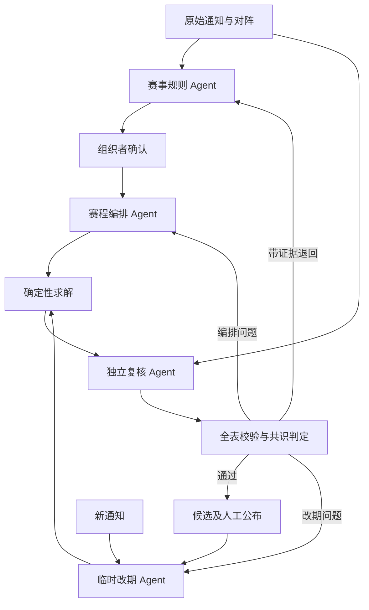

# 校园赛事赛程编排与临时改期助手

结课方向三 · 多 Agent 协作系统（系统设计）｜榆园杯及全部队名、通知均为虚构样例。本项目使用 Codex 辅助开发、调用模型和整理材料。

## 一、项目概述

校园比赛公布赛程以后，临时借不到场地是组织者最难解释的情况之一。重新做出一张可执行的表只是第一步，队长更关心自己原来几点到场、现在要不要改，以及调整是否违反此前商定的条件。本项目把问题限定为单日赛事，由组织者提供对阵，系统负责安排时间和场地。样例中八支队伍在两块场地完成五场比赛，其中青禾和星桥各上场两次，海棠与石榴还借用同一名守门员。仅查看场地有没有空档，容易漏掉共享人员和赛间休息。

选择系统设计方向，是因为规则解释、可行性判断与变更说明需要不同证据。四个角色分别提取规则、编排首版、独立复核及处理临时通知。系统保留逐轮产物、原文引句和已公布版本，供组织者从某一场比赛追溯到决策依据。最终交付物是经核查的赛程和需要通知的队伍名单。对确实排不开的赛事，组织者能看到受阻场次，并在核实资源条件后决定是否调整原要求。

## 二、系统设计



四个角色共享 DeepSeek 服务，各自发起请求。规则角色只能提取有原文依据的约束；编排角色收到确认清单后请求求解；改期角色额外读取旧表和新通知；复核角色先在看不到规则摘要与人工答案的条件下独立读原文，再对照候选、清单和校验结果。模型不能通过自行填写“已通过”来发布比赛。状态转换由本机程序决定，规则不全、待澄清或工具发现违规都阻断发布。

系统将赛事作为一次运行保存。每次求解留存候选、搜索预算及真实状态，复核记录指向同一候选的版本号。组织者的发布动作才会追加一个版本。一次运行可以有多个退回产物，但公布历史始终按发布顺序排列。浏览器表单携带版本计数，进程内加锁后再检查该计数，重复提交旧页面会收到冲突响应。JSON 文件通过临时文件替换，保证单次写入完整。这一设计适合课堂单机运行，多机并发需要独立的事务存储。

协议另有一道分工边界。原始材料既是提取者的输入，也是复核者的输入；如果两者只传递摘要，那么被首轮遗漏的一句话会在下游永久消失。另一方面，调换时间和场地是否可行，可以用离散搜索给出可复现的答案。将这两项工作交由不同模块，使组织者能够分辨是通知含义存在分歧，还是有限资源确实无法容纳所有对阵。

|方向三原项|核查位置|真实运行或证据|
|---|---|---|
|多角色设计|agents.py 的 rules、schedule、review、change|main.json 同一赛事七次请求|
|多轮协作迭代|workflow.py 的 candidate、extract|active.json 退回直接影响名单，pair_fault.json 修复规则表|
|容错共识规则|issues、独立盲读与状态门槛|injected.json 留待确认，impossible.json 保存旧版|
|可验证协作记录|Event.ask、attempts、events、versions|main.json 可见输入、输出、模型、用量及耗时|
|高质量成果产出|diff、工作台表格、版本对照|main.json 的 V1/V2，图一及真实 HTTP 操作验收|

## 三、实现细节

所有比赛沿用对阵录入时分配的编号。时间存为午夜起算的分钟数，原始样例从 780 分钟开放到 1080 分钟，仅允许整点开球。场地占用区间左闭右开，前一场结束时下一场可以进场。同队最短休息从前一场结束时开始计算，例如一场十三点开始、十四点结束，球队最早可以在十五点再上场。程序先枚举每场的合法时间与场地，再按对阵顺序逐场尝试；只要部分赋值已违反硬规则，就无需扩展该分支。独立复核阶段从完整候选重新执行校验，包括比赛集合完整性。求解和复核共用约束实现，因此还需要边界单测来防止同一编码错误同时影响两个阶段。

规则项保存编号、类型、对象、时间与原文。例如“云杉队下午四点前无法到场”约束该队参加的全部比赛，而“白鹭队希望尽量晚一点开球”只计入软偏好代价。共享守门员约束需要对照两场比赛中的队伍，单独检查每队时间表无法发现。可见提示与回答留在事件列表中，程序验证引用是否真是输入材料的连续片段。一个确实存在的引句仍可能被解释错，所以复核者另做一份独立的原文清单，并按规则语义与对象进行交叉检查。

首版优先降低软偏好罚值，再使各场开始时间之和较早。改期时首先保证五场比赛都存在且全部硬规则满足，再依次比较移动场次数、移动比赛涉及的去重队伍数、偏好罚值及开始时间和。最末并列保留按场次、时间、场地枚举得到的第一个解。核心比较量见 engine.py：

```python
cost = (len(moved), len(teams), penalty(part, rules, matches),
        sum(t for t, v in part.values()))
```

同一编号的时间或场地任一变化便计为一场，同时变化仍计一次。从时间或场地发生变更的比赛中收集参赛队并去重，同一支队涉及多场变更仍只计一次。系统生成需要通知的队伍名单，实际联系由组织者负责。求解器可以调整未直接受影响的比赛，为更少的总改动创造空间。使用三秒的固定预算，遍历完成且找到解才标记最优；中止时有候选和没有候选对应不同状态。两座场地都停用时，五个单场可行域已经为空，无解有具体资源依据。撤回维修限制的试算另外保存，实际公布状态不会因此变化。

开发中遇到过两类协议问题。早期编排请求缺少明确的 JSON 提示而被服务端拒绝。另一次复核返回了 issues 却漏掉必需的工具字段。项目保留这两份失败记录，当前实现把结构错误及上次可见回答回传一次，继续失败就停下。业务层默认最多三轮；同一候选和同一问题重复出现则更早退出。改期主线七次调用依次为规则、编排、复核盲读、复核判定、改期、复核盲读、复核判定，合计 5286 个 API 返回的 token。原始证据见 [main.json](evidence/main.json)。

## 四、测试验证

首轮产物与人工答案在运行前分开保存，答案冻结在首次提交 b62b356。深度突破候选比较相同首轮输出经程序校验和增加独立复核后的表现。三个自然案例的六条参考规则均在首轮命中，增加复核没有提高正确条数，却将每例调用从两次增至四次。人工注入另计：删去共享守门员规则后，程序仍能接受这份不完整规则表生成的赛程；复核者从原文找回该限制。它也提出了无依据的疑问，候选因此停在待确认状态，未发布。规则字段统计与是否准予公布必须分别阅读。

单条限制的附加注入试验更容易现场核对。原文为“海棠队和石榴队共用守门员，禁止同时比赛。”首轮丢失该条后，M03、M04 同在十四点。复核盲读清单提出共享人员证据，退回规则角色后，M04 从十四点二号场地改到十五点一号场地。下一轮复核对语义仍有疑问，候选未发布。方向突破候选在同一旧表和三秒预算下比较两种求解目标。二号场地停用后，五场比赛全部保留，只有 M04 石榴队对飞萤队由 13:00 二号场地移到 14:00 一号场地，需要通知这两队。两种方法在此例均只移动 1 场。追加的星桥队请假案例中，从头排程移动 4 场，低扰动改期移动 1 场，需要通知的队伍由 7 支减至 2 支。双场维修时两法均证明无解。


本机离线验收共 26 项，全部通过，失败与错误均为 0。[逐项记录](evidence/tests.json)。离线自动化覆盖时间边界、模型失败后阻止发布、同队休息、共享人员、超时、规则遗漏、版本保留与通知去重。网页另做真实 HTTP 表单验收，两次发布后重放旧请求均被拒绝。本次尚未收集真人反馈。以下数表由落盘结果生成，保留相同结果、失败状态与 API 耗时。

### A　独立原文复核（深度突破候选）

|案例|首轮漏/多|纠正|新引入的规则字段错误|最终遗漏|模型调用（基线→复核）|模型秒数（基线→复核）|
|---|---:|---:|---:|---:|---:|---:|
|主赛事|0/0|0|0|0|2 → 4|3.40 → 5.64|
|补充通知|0/0|0|0|0|2 → 4|3.18 → 6.13|
|正常对照|0/0|0|0|0|2 → 4|2.06 → 4.29|
|人工注入|1/0|1|0|0|2 → 5|2.87 → 8.81|

按类型、对象及时间比较规则集合。人工注入行的最终规则表已修复，仍有三条待确认意见，未发布。字段统计不包含自由文本误报。耗时仅累计模型请求；首版比较不包含后续改期。

### B　已公布赛程的低扰动改期（方向突破候选）

|同一变更|移动场次（从头→低扰动）|需要通知的队伍数|偏好罚值|求解秒数|两法状态|
|---|---:|---:|---:|---:|---|
|二号场全程停用|1 → 1|2 → 2|0 → 0|0.0049 → 0.0054|OPTIMAL → OPTIMAL|
|青禾13—14点请假|0 → 0|0 → 0|0 → 0|0.2026 → 0.2009|OPTIMAL → OPTIMAL|
|星桥13—14点请假|4 → 1|7 → 2|0 → 0|0.1911 → 0.1874|OPTIMAL → OPTIMAL|
|二号场末时段停用|0 → 0|0 → 0|0 → 0|0.1383 → 0.1415|OPTIMAL → OPTIMAL|
|双场全程维修|— → —|— → —|— → —|0.0001 → 0.0001|INFEASIBLE → INFEASIBLE|

罚值为偏离理想开球时间的累计小时，越低越好。无解时没有移动数。青禾案例的两次离线求解均通过校验，该次在线复核输出结构错误，未发布。星桥案例是检查不同缺席对象后追加的场景，用于展示机制，不能据此估计平均收益。


## 五、总结反思

将需要通知的队伍数纳入改期目标后，组织者可以直接判断哪些队伍需要收到变更通知。赛程对照表保留原时间和场地，组织者能按场次核实调整原因，再联系相关队伍。

通过这个项目，我对多 Agent 协作中为什么需要独立复核有了更具体的理解。在共享守门员规则的故障注入实验中，程序按缺少这条限制的规则表排出了赛程，M03 和 M04 被安排在同一时间。复核 Agent 从原始通知中找回限制后，M04 才被移到下一时段。这让我认识到，即使排程通过了程序校验，仍要检查规则表是否完整。另一方面，三个自然案例中，首轮已经提取了全部参考规则，增加复核只增加了调用开销。今后评价协作效果时，我会同时看它纠正了什么、引入了哪些新疑问，以及多花了多少次调用。

四个角色共用同一模型，仍可能出现相同的判断偏差。后续可扩充自然通知和人工标注，统计复核误报率。当前最优性证明只覆盖单日整点网格和固定时长；跨天赛制、异长比赛和多进程写入仍需另行设计。两项突破均为加分候选，由教师评定。
