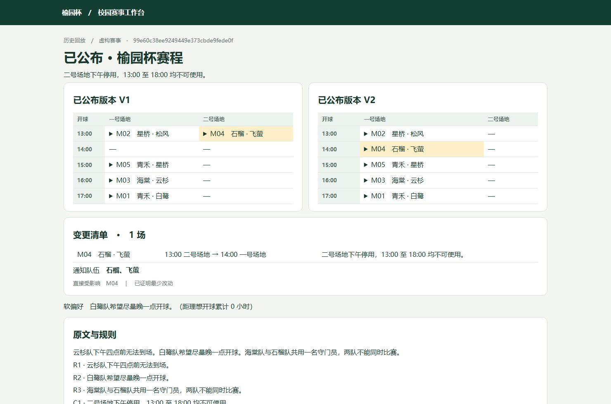
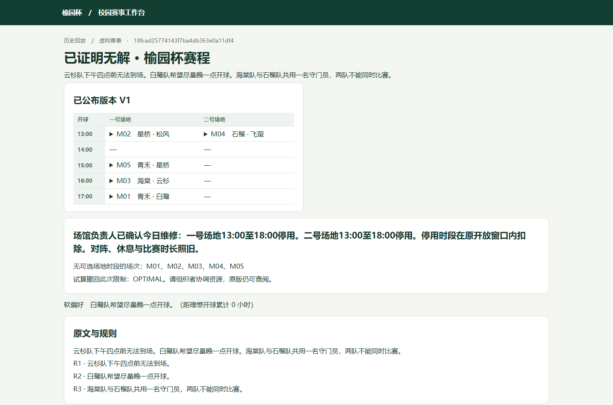

# 校园赛事赛程编排与临时改期助手

结课方向三 · 多 Agent 协作系统（系统设计）｜榆园杯、队伍与通知均为虚构样例。本项目使用 Codex 辅助开发和整理材料。

## 一、项目概述

### 1.1 方向选择理由

同一份赛事通知里，“下午四点前无法到场”和“希望尽量晚一点”对排程有不同含义。理解这两句话需要读原文，判断两支队伍能否在同一时段开球还要计算场地、休息时间和共享人员。若负责解释通知的角色漏掉一句话，后面的计算即使正确，也可能排出无法执行的赛程。因此选择方向三，把规则解释、首版编排、独立复核和临时改期分给四个角色。

### 1.2 项目目标

使用者是小型校园赛事的组织者。赛前，他提供对阵清单、场地条件和队长反馈，得到一张可以公布的单日赛程。公布后，遇到场地维修或球队请假，他需要尽量保留仍然可行的安排，拿到新版赛程、逐场变更原因和需要通知的队伍名单，才能有针对性地联系队长。

### 1.3 核心功能

组织者先录入通知，逐条核对规则及原文，澄清疑问后生成首版候选。复核通过后，他在页面上公布赛程。收到临时通知时，他可以并排查看新旧两版，点开移动的比赛检查时间、场地及依据。如果所有空档都不合适，页面保留原版，并把是否协调资源的决定交还给他。

## 二、系统设计

### 2.1 系统架构图


*图 1　系统组成与调用方向。箭头从发起操作的一方指向接收方。*

首次编排时，界面把已确认的规则交给流程控制，控制器向角色发起请求，并在本机执行求解和校验。复核发现分歧后，控制器保存当轮候选，把问题及原文交回相应角色重新提交。通过复核的候选进入“可公布”状态，组织者点击公布才会追加正式版本。

### 2.2 模块说明

| 模块 | 职责 | 主要输入与输出 | 实现文件 |
|---|---|---|---|
| 组织者界面 | 录入、确认、公布和回放 | 对阵、通知、操作 → 赛程对照与名单 | `app.py` |
| 协作流程控制 | 分派角色、调用工具、决定状态 | 赛事状态与上一轮反馈 → 候选或退回意见 | `workflow.py` |
| 赛事规则 Agent | 提取有依据的规则 | 通知与队长反馈 → 规则表、引句、待确认项 | `agents.py` |
| 赛程编排 Agent | 组织首版编排 | 已确认规则与对阵 → 求解请求、规则编号 | `agents.py` |
| 独立复核 Agent | 盲读原文，再核对候选 | 原文 → 独立清单；清单、候选与校验结果 → 复核意见 | `agents.py` |
| 临时改期 Agent | 解释新增限制及影响 | 旧表与新通知 → 改期请求、直接受影响场次 | `agents.py` |
| 排程与校验工具 | 执行搜索、检查约束、比较版本 | 规则、固定对阵与可选旧表 → 求解状态、违规项或差异 | `engine.py` |
| 运行记录与版本 | 保存调用和每轮产物 | 角色回答、工具结果、发布操作 → 可回放的赛事记录 | `agents.py`、`workflow.py` |

每次运行都有独立编号。同一场比赛的编号跨版本保留，因此按场次查阅候选时，可以继续找到当时使用的规则、产生分歧的那一轮以及最终公布的位置。即使候选未获通过，它仍可作为核对退回理由的依据。[方向三五项要求的证据对照](requirements_checklist.md)

### 2.3 关键设计决策

**分开解释与计算。** 队长可以用日常语言描述限制，模型负责识别对象、语气和原文依据。确认后的时间区间、同队休息和共用人员约束由程序统一计算。这样，组织者既能追问一句话为何被当作硬规则，也能在相同规则下重复检查某张赛程。

**给复核者独立的原文入口。** 如果复核者只能看到提取摘要，被漏掉的句子就没有机会进入复核。先单独重建清单，再与排程所用规则对照，才能区分“某场排错了”和“某条规则根本没有进入排程”，并把问题退给合适的角色。

**保留已公布版本作为改期参照。** 已向队长公布的时间具有联络成本，两张都可行的表可能要联系不同数量的队伍。系统先比较移动了几场，再把这些比赛的参赛队去重。同一队涉及多场变更只算一次，组织者据此决定要联系谁。

## 三、实现细节

### 3.1 核心代码片段

第一段摘自 `workflow.py` 的 `Event.candidate`，位于当轮复核发现问题之后。

```python
d["feedback"]=problems
signature=json.dumps([rules,plan,[(p["target"],p.get("rule"),p.get("matches")) for p in problems]],sort_keys=True)
if signature in seen: d["status"]="无进展，待组织者处理"; break
seen.add(signature)
previous=deepcopy(attempt)
if any(i["target"]=="rules" for i in problems):
    before=d["rules"]
    self.extract(problems,n+1)
```

输入是一份候选和针对它的问题清单。每条意见标明退回对象，并可携带原文、规则编号和场次。程序先记录完整反馈，再判断当前规则、候选与问题组合是否已经出现过。若组合重复，继续询问只会重走同一轮，系统就停下来。遇到规则解释问题，最后一行直接把问题传给规则角色，让它对照上轮清单重新提取。若是首版编排或改期问题，下一轮请求会带上反馈以及这里保存的候选副本，角色可以据此修正具体场次。修订过程保留旧候选，便于事后判断这次修改到底回应了哪条意见。

第二段摘自 `engine.py` 的 `solve`，是内部搜索函数 `visit` 处理完整候选时的比较逻辑。

```python
moved,teams=diff(old,part,matches) if old else ([],[])
cost=(len(moved),len(teams),penalty(part,rules,matches),sum(t for t,v in part.values()))
if reconsider:
    cost+=(sum(tuple(part[m])==tuple(slot) for m,slot in reconsider.items()),)
if score is None or cost<score: best,score=part.copy(),cost
```

输入的候选已排入全部比赛，搜索过程中每增加一场就检查一次硬约束。有旧表时，程序用稳定的比赛编号对齐两个版本。开球时间和场地只要有一项变化就记一场，两项都变也只记一场。元组从左到右比较，因此先减少移动场次，再减少涉及队伍，随后才比较偏好罚值和开球时间总和。收到针对场次的修订意见时，最后一个比较项使并列方案优先尝试不同位置。没有旧表时前两项均为零，搜索自然回到首版目标。只有更优的候选才替换当前解，完全并列时保留先枚举到的方案。

### 3.2 关键配置

| 项目 | 类型与取值 | 作用 |
|---|---|---|
| 模型与凭据 | 可配置；实测 `deepseek-flash`，变量 `DEEPSEEK_MODEL`、`DEEPSEEK_API_KEY` | 选择已授权服务 |
| 角色调用 | 固定协议；四份角色提示，各自发起独立请求 | 分别记录可见输入、输出及实际用量 |
| 协作轮数 | 可配置；`TOURNAMENT_MAX_ROUNDS` 默认 3，范围 1—10 | 限制持续分歧的轮数 |
| 开球网格 | 固定；单日 13:00—18:00，整点开球 | 最迟 17:00 开始 |
| 时长与休息 | 固定；每场 60 分钟，同队至少休息 60 分钟 | 从上一场结束时计算休息 |
| 求解预算 | 函数参数；对照实验每种模式每次 3 秒 | 同预算比较两种目标 |

区间左闭右开。例如一场十三点开球，十四点结束，场地此时可交给别队，同一支队伍则最早十五点再开球。预算用尽时还要看是否已有完整候选：有候选只能说明找到可行方案，没有候选则记录超时未找到方案。只有遍历结束才能宣称在给定网格下最优或确实无解。轮数限制管的是角色间反复修订，求解预算管的是一次搜索，两者分别记录。

### 3.3 遇到的问题与解决

**复核回答缺少工具字段。** 早期网页运行收到的问题数组为空，却无法进入公布步骤。查看可见回答发现，模型遗漏了协议要求的工具字段，程序无法把这份回答识别为有效复核。现在控制器会把结构错误提示和上次回答一并返回，允许再答一次；再次失败就记录调用失败。原运行停在失败状态。后续独立的网页验收完成了两次发布，其记录中没有触发格式重试，因此它验证的是正常发布路径。[失败记录](evidence/prototype/ui-format-error.json) · [网页验收](evidence/ui-59504551fc1f41df93a3846f426dae80.json)

**把球队参赛误当作场次受影响。** 星桥只在十三点到十四点无法参赛，改期角色首轮却同时列出两场。原因是另一场虽有星桥参赛，开球时间并未落在请假窗口。程序把新限制套在旧表上，核出只有 M02 直接受影响，并把这个编号传回改期角色。第二轮名单从 M02、M05 收窄到 M02，复核通过后公布新版。这次记录可以沿反馈找到实际修正的对象。[改期记录](evidence/active.json)

## 四、测试验证

### 4.1 测试用例

验证分成两层。离线测试固定输入，检查边界、版本和失败处置；真实模型运行另行保留每次交接，用来判断系统能否把原文变成可执行的安排。人工注入时有意删除规则，单独统计，以免将人为制造的遗漏误记为模型自然漏读。

| 场景及来源 | 输入 | 预期 |
|---|---|---|
| 正常公布 · 真实运行 | 原始通知与五组对阵 | 五场都排入，复核通过后可公布 |
| 临时改期 · 真实运行 | 二号场全程停用 | 保留旧版，列出差异和需要通知的队伍 |
| 多轮纠错 · 真实运行 | 星桥短时请假 | 核对实际冲突的场次，将误报退回 |
| 规则遗漏 · 人工注入、真实复核 | 从规则表移除共享守门员限制 | 复核能从原文找回限制 |
| 无解 · 真实运行及离线测试 | 两块场地全程维修 | 五场都无空档，保留已公布版 |
| 时间边界 · 离线测试 | 相邻开球、休息恰好达标或差一分钟 | 区分可衔接的场地与未休息足够的球队 |

### 4.2 测试结果

**基础功能验证。** 冻结记录中 26 项离线测试全部通过。主线运行编号为 `99e60c38ee9249449e373cbde9fede0f`，同一赛事的七次请求覆盖四个角色。二号场停用后，五场全部保留。只有石榴队对飞萤队的 M04 从 13:00 二号场地移至 14:00 一号场地，需要通知这两队。[逐项测试](evidence/tests.json) · [主线交接](evidence/main.json)



*图 2　沿两张表中的黄色 M04 对照旧位置和新位置，表下方列出对应队伍。*

双场全程维修时，每场的可用位置都为空，搜索能证明无解。系统另做一次撤回新增限制的试算，证实可恢复可行，然后将决定交回组织者。[无解记录](evidence/impossible.json)



*图 3　无解页面保留已公布版；候选试算没有替换原赛程。*

**深度突破候选——独立原文复核。** 这一实验深化方向三的容错共识与核查。三个自然案例共六条参考规则，首轮已全部命中，增加复核未观察到准确率提升，每例首版调用由两次增至四次。另看单条限制的人工注入试验：从规则表删去共享守门员限制后，M03 与 M04 同在十四点开球。复核者从原文找回限制，修订候选把 M04 移至十五点。复核仍提出待确认意见，候选最终未公布。[注入与修订记录](evidence/pair_fault.json)

**方向突破候选——已公布赛程的低扰动改期。** 新增技术是把原赛程纳入优化目标。在同一旧表、变更和求解预算下，两种模式都先通过硬约束校验。下表每格依次给出移动场次和需要通知的队伍数。星桥请假是追加案例，能说明何时出现收益，尚不足以估计一般赛事的平均收益。[逐例耗时与完整实验表](experiments.md)

| 变更 | 从头排程 | 低扰动改期 |
|---|---:|---:|
| 星桥队请假（追加） | 4 场 / 7 队 | 1 场 / 2 队 |
| 二号场停用 | 1 场 / 2 队 | 1 场 / 2 队 |

### 4.3 用户反馈

本次尚未收集真实用户反馈。现有证据可以核对赛程是否可行、发布是否受控；组织者能否在没有提示的情况下找全需要联系的队伍，仍有待实际试用检验。

## 五、总结反思

### 5.1 项目亮点

组织者可以从一条退回意见找到对应的原句，再看到哪条规则、哪场比赛因它而改动。公布后遇到变更，用同一个比赛编号就能对照前后位置，沿着移动场次找到需要联系的队长。这样的结果既能交给队伍执行，也能在有人询问调整理由时说明依据。

### 5.2 不足与改进方向

目前每场比赛占同样长的整点时段。若校园赛事改为长短场混排，应先给每场记录实际时长，再据此检查场地交接和休息边界。自然通知的样本也较少，后续可让不同编写者提供含补充说明或模糊措辞的通知，事先独立标注参考答案，检验在哪些条件下增加复核值得付出调用成本。

### 5.3 个人收获

共享守门员的案例让我意识到，程序校验只能判断已编码的规则有没有被违反。要发现缺失的限制，复核者必须能回到原始通知，说明究竟漏了哪一句。我也看到，找回一条规则以后，复核仍可能提出多余的疑问。今后评价多轮协作，我会一起检查它纠正了什么、留下了哪些新疑问，以及为了这些变化多用了多少次调用。
