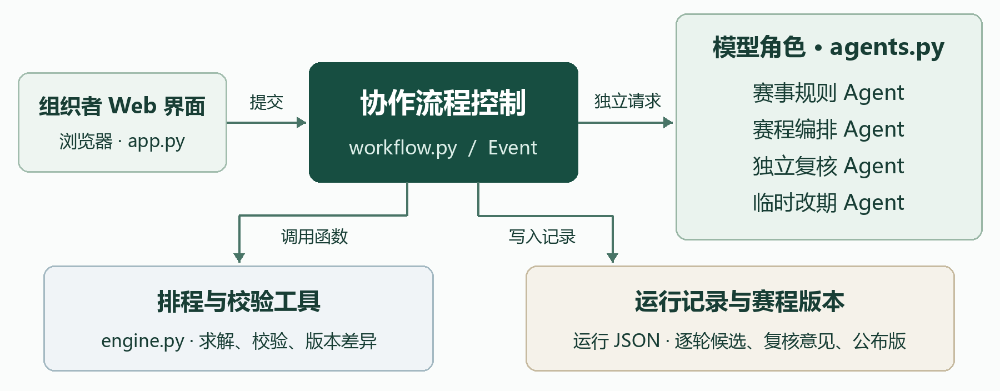

# 校园赛事赛程编排与临时改期助手

结课方向三 · 多 Agent 协作系统（系统设计）｜榆园杯、队伍与通知均为虚构样例。本项目使用 Codex 辅助开发和整理材料。

## 第一章 项目概述

### 1.1 方向选择理由

榆园杯的组织者要把队长的话变成一张大家都能执行的表。“下午四点前无法到场”决定哪些时段可用，“希望尽量晚一点”只影响可行方案之间的选择。即使分清了这两句话，还要算出何时有空场、球队是否休息足够。公布前也得有人重读通知，检查是否漏掉了共用守门员这样的跨队限制。这三项工作需要不同的依据，因此选择方向三“多 Agent 协作系统”。

### 1.2 项目目标

小型校园赛事的组织者在浏览器中输入对阵清单、赛事通知和队长反馈，赛前得到经过核查、可以公布的单日赛程。公布后若场地停用或球队临时请假，他要知道哪几场必须调整、原来的安排能保留多少，以及新版中每场为何移动、需要联系哪些队伍。

### 1.3 核心功能

组织者先在 Web 端查看提取的规则和原文，确认后生成首版候选，复核通过即可公布。收到临时通知时，他在同一页面提交变更，对照新旧赛程查看移动场次、原因和去重后的队伍名单。实际联系由组织者负责。如果排不开，他仍能查看原版，并根据冲突说明决定是否协调场地。

## 第二章 系统设计

### 2.1 系统架构图



*图 1　系统组成与调用方向。箭头从发起操作的一方指向接收方。*

图 1 中，Web 端把操作交给流程控制器。首版使用已确认规则，改期还传入已公布版本与新通知；两条路径都由控制器请求角色并调用本地函数。规则释义有误退回规则角色，首版或改期候选有误分别退回编排或改期角色。复核通过后，组织者点击公布，控制器才把候选追加为正式版本。

### 2.2 模块说明

| 模块或角色 | 职责 | 接收什么 | 交付什么 |
|---|---|---|---|
| Web 界面 | 录入、确认、公布与回放 | 对阵清单、通知、组织者操作 | 赛程对照、变更原因与名单 |
| 协作流程控制 | 分派角色并决定能否公布 | 赛事状态、角色回答、校验结果 | 工具调用、定向反馈、候选状态 |
| 赛事规则 Agent | 区分硬约束与软偏好 | 原始通知、队长反馈 | 带编号和原文引句的规则、待确认项 |
| 赛程编排 Agent | 组织首版求解请求 | 确认规则、对阵、上一轮反馈 | 求解请求、规则编号及理由 |
| 独立复核 Agent | 先盲读，再审查候选 | 原文；第二次请求另附候选与校验结果 | 独立规则清单、问题依据及退回对象 |
| 临时改期 Agent | 解释新增限制并识别直接影响 | 已公布赛程、规则、新通知 | 改期请求、新限制与直接受影响场次 |
| 排程与校验工具 | 执行搜索、验算约束、计算差异 | 对阵、规则及可选旧表 | 候选赛程、求解状态、违规项与变更队伍 |
| 运行记录与版本 | 保存每次交接和发布结果 | 角色输入输出、工具结果、发布操作 | 可按运行编号回放的记录与各版赛程 |

运行编号串起同一赛事的全部请求，比赛编号则在不同版本间保持稳定。查某场为何移动时，可以先按比赛编号找到新旧位置，再查该轮控制器收到哪条反馈、怎样处理。即使候选没有公布，当轮的规则和求解结果也会保存。

### 2.3 关键设计决策

**分开解释与计算。** 队长可以用日常语言描述限制，模型负责识别对象、语气和原文依据。确认后的时间区间、同队休息和共用人员约束由程序统一计算。这样，组织者既能追问一句话为何被当作硬规则，也能在相同规则下重复检查某张赛程。

**给复核者独立的原文入口。** 如果复核者只能看到提取摘要，被漏掉的句子就没有机会进入复核。先单独重建清单，再与排程所用规则对照，才能区分“某场排错了”和“某条规则根本没有进入排程”，并把问题退给合适的角色。

**保留已公布版本作为改期参照。** 已向队长公布的时间具有联络成本，两张都可行的表可能要联系不同数量的队伍。系统先比较移动了几场，再把这些比赛的参赛队去重。同一队涉及多场变更只算一次，组织者据此决定要联系谁。

## 第三章 实现细节

### 3.1 核心代码片段

第一段摘自 `workflow.py` 的 `Event.candidate`，位于当轮复核发现问题之后。

```python
d["feedback"]=problems
signature=json.dumps([rules,plan,[(p["target"],p.get("rule"),p.get("matches")) for p in problems]],sort_keys=True)
if signature in seen: d["status"]="无进展，待组织者处理"; break
seen.add(signature)
previous=deepcopy(attempt)
if any(i["target"]=="rules" for i in problems):
    before=d["rules"]
    self.extract(problems,n+1)
```

这里的输入是当轮候选及复核产生的问题清单。每条意见标明退回对象，并可携带原文、规则编号和场次。程序先记录完整反馈，再判断当前规则、候选与问题组合是否已经出现过。若组合重复，继续询问只会重走同一轮，系统就停下来。遇到规则解释问题，最后一行直接把问题传给规则角色，让它对照上轮清单重新提取。若是首版编排或改期问题，下一轮请求会带上反馈以及这里保存的候选副本，角色可以据此修正具体场次。修订过程保留旧候选，便于事后判断这次修改到底回应了哪条意见。

第二段摘自 `engine.py` 的 `solve`，是内部搜索函数 `visit` 处理完整候选时的比较逻辑。

```python
moved,teams=diff(old,part,matches) if old else ([],[])
cost=(len(moved),len(teams),penalty(part,rules,matches),sum(t for t,v in part.values()))
if reconsider:
    cost+=(sum(tuple(part[m])==tuple(slot) for m,slot in reconsider.items()),)
if score is None or cost<score: best,score=part.copy(),cost
```

输入的候选已排入全部比赛，搜索过程中每增加一场就检查一次硬约束。有旧表时，程序用稳定的比赛编号对齐两个版本。同一场的开球时间或场地有变化就计为移动一场，两项都变也只计一次。计算涉及队伍时，程序只收集这些移动场次的参赛队，并对队名去重；同一队的两场都移动也只需联系一次。元组从左到右比较，因此先减少移动场次，再减少涉及队伍，随后才比较偏好罚值和开球时间总和。收到针对场次的修订意见时，最后一个比较项使并列方案优先尝试不同位置。没有旧表时前两项均为零，搜索自然回到首版目标。只有更优的候选才替换当前解，完全并列时保留先枚举到的方案。

### 3.2 关键配置

| 项目 | 类型与取值 | 作用 |
|---|---|---|
| 模型与凭据 | 可配置；实测 `deepseek-flash`，变量 `DEEPSEEK_MODEL`、`DEEPSEEK_API_KEY` | 选择已授权服务 |
| 角色调用 | 固定协议；四份角色提示，各自发起独立请求 | 分别记录可见输入、输出及实际用量 |
| 协作轮数 | 可配置；`TOURNAMENT_MAX_ROUNDS` 默认 3，范围 1—10 | 限制持续分歧的轮数 |
| 开球网格 | 固定；单日 13:00—18:00，整点开球 | 最迟 17:00 开始 |
| 时长与休息 | 固定；每场 60 分钟，同队至少休息 60 分钟 | 从上一场结束时计算休息 |
| 求解预算 | 函数参数；对照实验每种模式每次 3 秒 | 同预算比较两种目标 |

区间左闭右开。例如一场十三点开球，十四点结束，场地此时可交给别队，同一支队伍则最早十五点再开球。预算用尽时还要看是否已有完整候选：有候选只能说明找到可行方案，没有候选则记录超时未找到方案。只有遍历结束才能宣称在给定网格下最优或确实无解。轮数限制管的是角色间反复修订，求解预算管的是一次搜索，两者分别记录。

### 3.3 遇到的问题与解决

**复核回答缺少工具字段。** 早期网页运行收到的问题数组为空，却无法进入公布步骤。查看可见回答发现，模型遗漏了协议要求的工具字段，程序无法把这份回答识别为有效复核。现在控制器会把格式反馈和上次可见回答一起交回原角色，允许再答一次；再次失败就记录调用失败。原运行停在失败状态。后续独立的网页验收完成了两次发布，其记录中没有触发格式重试，因此它验证的是正常发布路径。[失败记录](evidence/prototype/ui-format-error.json) · [网页验收](evidence/ui-59504551fc1f41df93a3846f426dae80.json)

**把球队参赛误当作场次受影响。** 星桥只在十三点到十四点无法参赛，改期角色首轮却同时列出两场。原因是另一场虽有星桥参赛，开球时间并未落在请假窗口。程序把新限制套在旧表上，核出只有 M02 直接受影响，并把这个编号传回改期角色。第二轮名单从 M02、M05 收窄到 M02，复核通过后公布新版。这次记录可以沿反馈找到实际修正的对象。[改期记录](evidence/active.json)

## 第四章 测试验证

### 4.1 测试用例

离线测试检查约束边界和发布状态；真实运行检查角色交接。人工注入的遗漏单列，便于与自然漏读区分。

| 场景及来源 | 输入 | 预期 |
|---|---|---|
| 正常公布 · 真实运行 | 原始通知与五组对阵 | 五场都排入，复核通过后可公布 |
| 临时改期 · 真实运行 | 二号场全程停用 | 保留旧版，列出差异和需要通知的队伍 |
| 多轮纠错 · 真实运行 | 星桥短时请假 | 核对实际冲突的场次，将误报退回 |
| 规则遗漏 · 人工注入、真实复核 | 从规则表移除共享守门员限制 | 复核能从原文找回限制 |
| 无解 · 真实运行及离线测试 | 两块场地全程维修 | 五场都无空档，保留已公布版 |
| 时间边界 · 离线测试 | 相邻开球、休息恰好达标或差一分钟 | 区分可衔接的场地与未休息足够的球队 |

### 4.2 测试结果

**基础功能验证。** 26 项离线测试全部通过，失败与错误均为零。主线运行编号为 `99e60c38ee9249449e373cbde9fede0f`，同一赛事的七次请求覆盖四个角色。二号场停用后，五场全部保留。只有石榴队对飞萤队的 M04 从 13:00 二号场地移至 14:00 一号场地，需要通知这两队。[逐项测试](evidence/tests.json) · [主线交接](evidence/main.json)


*图 2　沿两张表中的黄色 M04 对照旧位置和新位置，表下方列出对应队伍。*

图 3 中双场全程维修，五场均无可选位置。撤回维修限制的试算恢复可行，由组织者决定是否协调。[无解记录](evidence/impossible.json)


*图 3　无解页面保留已公布版；候选试算没有替换原赛程。*

**深度突破候选——独立原文复核。** 这一实验深化方向三的容错共识与核查。三个自然案例共六条参考规则，首轮已全部命中，增加复核未观察到准确率提升，每例首版调用由两次增至四次。另看单条限制的人工注入试验：从规则表删去共享守门员限制后，M03 与 M04 同在十四点开球。复核者从原文找回限制，修订候选把 M04 移至十五点。复核仍提出待确认意见，候选最终未公布。[注入与修订记录](evidence/pair_fault.json)

**方向突破候选——已公布赛程的低扰动改期。** 新增技术是把已公布赛程纳入优化目标。两种方法使用相同规则及预算，所得赛程均通过校验。表中每格依次为移动场次、需要通知的队伍数。星桥请假是追加案例，收益不能直接推广到其他赛事。[逐例耗时与完整实验表](experiments.md)

| 变更 | 从头排程 | 低扰动改期 |
|---|---:|---:|
| 二号场停用 | 1 场 / 2 队 | 1 场 / 2 队 |
| 星桥队请假（追加） | 4 场 / 7 队 | 1 场 / 2 队 |

**方向三五项技术要求与实际证据**

| 课件原项 | 在本项目中观察到的证据 |
|---|---|
| 多角色设计 | 同一赛事先由规则角色提取、编排角色请求求解，公布后由改期角色解释停用通知；独立复核角色在两个阶段分别核查。 |
| 多轮协作迭代 | 星桥请假首轮列出 M02、M05。程序反馈只有 M02 与请假时段相交，改期角色在第二轮修正，复核通过并公布。 |
| 容错共识规则 | 删除共享守门员规则后，原候选能通过程序校验。复核找回限制后仍有待确认意见，系统保留候选并停止公布。 |
| 可验证协作记录 | 主线运行的七次请求依次为规则、编排、复核盲读、复核判定、改期、复核盲读、复核判定。每次均存有轮次、可见输入输出和耗时，可关联 V1、V2。 |
| 高质量成果产出 | 图 2 中可逐格核对 V1、V2。差异清单给出 M04 的旧位置、新位置和移动原因，队伍名单与该场双方一致。 |

### 4.3 用户反馈

本节依据 Web 原型的运行回放整理作者反馈；两位同学的意见均为角色模拟，尚未收集真实同学的试用反馈。

**作者反馈：** 对照两张赛程表，我能数清五场比赛都保留了，再从黄色格子找到 M04 的新位置。并排看适合逐场核对；如果把唯一的变更先列在表格上方，打开页面就能看见重点。

**同学一（假设自己要负责这次校园比赛，场地停用后要通知各队队长）：** 我先看要联系谁。名单里是石榴队和飞萤队，旁边的变更清单也写了新旧位置。要是能直接复制一句“石榴队对飞萤队的比赛由 13:00 二号场地改至 14:00 一号场地”，我就能发到队长群里。

**同学二（假设自己是石榴队队长，要把新的比赛安排转达给队员）：** 我会先找“石榴队”和对手，很少记 M04 这样的编号。找到这场后，我要转告队员的就是“14:00，一号场地”。如果变更行先写双方队名，再把新时间和场地加粗，我扫一眼就能找到。

## 第五章 总结反思

### 5.1 项目亮点

组织者可以从一条退回意见找到对应的原句，再看到哪条规则、哪场比赛因它而改动。公布后遇到变更，用同一个比赛编号就能对照前后位置，沿着移动场次找到需要联系的队长。这样的结果既能交给队伍执行，也能在有人询问调整理由时说明依据。

### 5.2 不足与改进方向

当前 Web 原型固定整点开球、每场一小时。若要支持长短场混排，应先为每场记录时长，再用实际结束时间验算场地衔接和同队休息。变更结果也还有一步人工转录：组织者需要从表中整理发给队长的话。后续可以在差异行突出双方队名、新时间和场地，并在名单旁提供可复制的通知文本；消息仍由组织者自行发送。

### 5.3 个人收获

共享守门员的案例让我意识到，程序校验只能判断已编码的规则有没有被违反。要发现缺失的限制，复核者必须能回到原始通知，说明究竟漏了哪一句。我也看到，找回一条规则以后，复核仍可能提出多余的疑问。今后评价多轮协作，我会一起检查它纠正了什么、留下了哪些新疑问，以及为了这些变化多用了多少次调用。
